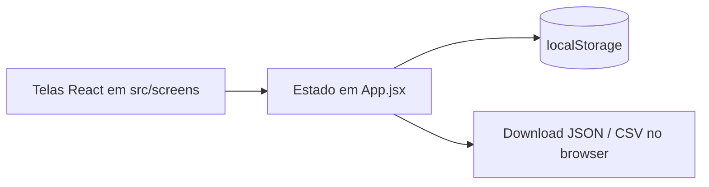

# Contagem de Doses — UBS / USF

Aplicativo web para registro e acompanhamento diário de doses aplicadas na vacinação da unidade (USF Lindalva Damasceno). Pensado para uso no celular ou tablet da equipe, sem depender de servidor.

## Requisitos

- Node.js 20+
- npm

## Desenvolvimento

```bash
npm install
npm run dev
```

Build de produção:

```bash
npm run build
npm run preview
```

## Arquitetura

**Tipo:** single-page application (SPA) — apenas cliente, sem backend neste repositório.

| Aspecto | Decisão |
| --- | --- |
| API HTTP | Não há. Não existem pastas `app/api`, `routes`, `server` nem funções serverless. |
| Banco de dados | Não há. Nenhum driver ou ORM nas dependências (`package.json`). |
| Persistência | `localStorage` do navegador (chave `contagem-dose-ubs`), sincronizado pelo estado em `src/App.jsx`. |
| Backup / troca de aparelho | Exportação e importação de JSON em `src/utils/exportData.js` (tela Definições). |
| Relatório diário | Ao finalizar o dia, gera CSV no dispositivo (`exportHistoricoCsv`). |

Fluxo resumido:



Navegação é controlada por estado local (`screen` em `App.jsx`), não por React Router.

## Estrutura do projeto

```
contagem-dose-ubs/
├── public/              # estáticos (ex.: brasao.png)
├── src/
│   ├── App.jsx          # estado global, persistência, roteamento por tela
│   ├── main.jsx         # entrada React
│   ├── components/      # UI reutilizável (contador, diálogos, cabeçalho…)
│   ├── screens/         # telas do fluxo de vacinação
│   ├── utils/           # datas, vacinas, exportação de arquivos
│   ├── icons/
│   └── styles/          # tokens e interações CSS
├── index.html
├── vite.config.js
└── package.json
```

## Stack

- React 19 + Vite 8
- CSS por componente (sem biblioteca de UI)
- Fontes: `@fontsource/inter`, `@fontsource/baloo-2`

## Funcionalidades (vacinação)

- Cadastro de vacinas (frascos, doses por frasco, lote, validade)
- Contagem do dia com carrossel e busca
- Finalizar dia (zera contagem do dia e arquiva no histórico)
- Histórico local e exclusão de registros
- Definições: backup JSON, importar backup, limpar dados

## Evolução futura

Se no futuro houver sincronização entre aparelhos ou painel central, isso exigiria um backend e banco **fora do escopo atual** — hoje o desenho é offline-first no navegador.
